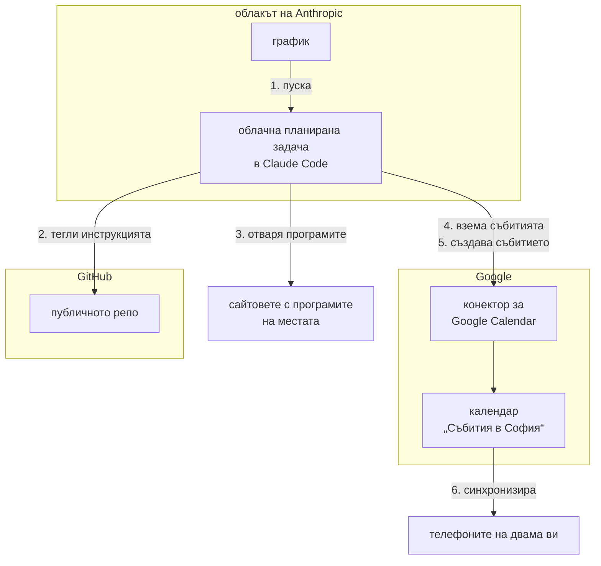

# Архитектура на решението

Избраното решение по [Задание.md, т. 2](Задание.md#2-ясна-задача-task), към 2026-11-12. Проучените варианти и резервните пътища са в [Автоматизация.md](Автоматизация.md), който е приключен и не се поддържа. Какво още предстои да се реши: вж. [Въпроси.md](Въпроси.md) и [Задачи за следващите части](Прогрес.md#задачи-за-следващите-части).

## Схема



Всяка стрелка тръгва от този, който действа. Номерът е стъпката от [Едно пускане](#едно-пускане), а рамките показват чия е всяка част.

## Части на решението

| Част | Какво е | Данни и настройки |
|---|---|---|
| **Репо** | Публичното [yankogovedarov/sofia-events-agent](https://github.com/yankogovedarov/sofia-events-agent). Клонът `main` е версията в продукция, от която задачата тегли инструкцията. Промените се правят в клон `dev` и влизат в `main` само по ваше решение (решение на потребителя от 2026-11-07). Версиите в `main` са с тагове `v1.0`, `v1.1` и т.н. | Агентът тегли само [Инструкция-агент.md](Инструкция-агент.md). В нея е всичко, което му трябва, включително местата и бюджетът, вж. [CLAUDE.md → Как се прилагат правилата](CLAUDE.md#как-се-прилагат-правилата). Тя остава тестовата версия, докато пълната от [част 3б](Прогрес.md#части-на-проучването) не влезе в `main` (решение на Claude от 2026-11-09) |
| **Облачна планирана задача** | Cloud scheduled task в Claude Code, доскоро „routine“. Върви в облака на Anthropic, затова не е нужно компютърът ви да е включен | Вж. [Работа на задачата](#работа-на-задачата) и [Права и достъп](#права-и-достъп) |
| **Конектор за Google Calendar** | Вграденият конектор на Claude. Прави го Google и това е Calendar MCP сървърът на Google (`calendarmcp.googleapis.com`) | Свързан е с личния ви Google акаунт. Правата: вж. [Права и достъп](#права-и-достъп) |
| **Календар „Събития в София“** | Отделен календар в Google Calendar за двама ви | Id-то не е в репото, вж. [Права и достъп](#права-и-достъп). Още не е споделен със съпругата ви, вж. стъпка 6 в [Стъпки за настройка](#стъпки-за-настройка). След споделянето събитията ще се виждат и в двата ви телефона, а известията ще работят при всеки от вас |

## Едно пускане

1. Графикът пуска задачата, вж. [Честота](#честота).
2. Задачата тегли от публичното репо [инструкцията](Инструкция-агент.md), вж. [Части на решението](#части-на-решението). Тя не клонира репото, а отваря файла по адрес в `raw.githubusercontent.com`, вж. [Мрежа](#мрежа).
3. Задачата отваря програмите на местата от инструкцията и избира събитията, които отговарят на нея.
4. Задачата взема през конектора събитията в календара за периода и проверява дали всяко избрано събитие вече е там, вж. [Дубликати](#дубликати). Страниците на събитията, които вече са там, не ги отваря.
5. Ако не е, задачата създава събитието през конектора по [Запис в календара](#запис-в-календара).
6. Google синхронизира календара с телефоните на двама ви.

## Запис в календара

Правилата за записа са в [Инструкция-агент.md → Запис в календара](Инструкция-агент.md#запис-в-календара). Защо са такива:

- **Календар.** Без `calendarId` събитието отива в основния календар.
- **Часова зона.** Без `timeZone` часът се тълкува в зоната на акаунта, а тя е UTC. При пробата в чат събитие за 19:00 се записа за 21:00 в София.
- **Гости.** Инструментът приема гости, а с тях тръгват покани. Само инструкцията пречи на агента да ги добави.

### Дубликати

Всяко събитие получава стабилен ключ: линк към събитието + дата и час. Точният вид на ключа и правилата на проверката са в [инструкцията](Инструкция-агент.md#запис-в-календара). Ключът стои в описанието на събитието, а преди да създаде ново, агентът проверява дали ключът вече е в календара. Проверката я прави самият агент, така че може да пропусне вече записано събитие и да го създаде втори път. Ако изтриете събитие от календара, ключът изчезва с него и следващото пускане ще го създаде наново, докато събитието е в програмата. Потребителят реши ключовете да стоят само в самите събития (2026-11-06).

### Записи от чат

През 2026 коледните базари не ги търси агентът, а Claude ги записва в чат с включен конектор, защото са няколко дълги събития с известни дати (отговор на въпрос 79). Дали пълната инструкция ще ги търси, се решава в част 3б, вж. [Прогрес.md → Задачи за следващите части](Прогрес.md#задачи-за-следващите-части). Решения на потребителя от 2026-11-12:
- Записът е в сесия с акаунта в claude.ai, в който е задачата, и само ако конекторът е оторизиран в сесията.
- Всеки базар е едно целодневно събитие (`allDay`) за целия период, а краят е денят след последния. Работното време и откриването са в описанието.

Ключът е „<линк към източника> <първия ден във вид YYYY-MM-DD>“ (решение на Claude). Датите на базарите са в [Индекс-места.md → Коледни базари](Индекс-места.md#коледни-базари).

## Права и достъп

- **Права на инструментите.** Задават се в Claude → Customize → Connectors → Google Calendar → Tool permissions. Потребителят ги зададе на 2026-11-07: `create_event`, `list_events`, `search_events` и `get_event` на Always allow, а `delete_event`, `update_event` и `respond_to_event` на Blocked. За проверката за [дубликати](#дубликати) е нужен `list_events`. Дали тези настройки важат и при пускане без надзор, е **непотвърдено**: при пробата на 2026-11-06 задачата виждаше всички инструменти, включително `delete_event`, но тогава правата още не бяха зададени. При всички пускания, след като правата са зададени (от 2026-11-08 до 2026-11-11), агентът виждаше `delete_event`, а при ръчното и при това на 2026-11-10 — и `update_event` и `respond_to_event`. Не ги извика, така че не е ясно дали щеше да бъде спрян. Отговорът на API за задачите съдържа и поле `permitted_tools` за всеки конектор. То не е описано в документацията и не е пробвано.
- **Прикачени конектори.** Задачата получава само конектора `Google_Calendar`. Ако при създаването ѝ не се посочат конектори, сървърът прикача всички свързани. Така при пробата бяха прикачени и `Claude_Docs` и `Claude_Code_Remote`.
- **Достъп.** Конекторът стига до всички календари на свързания акаунт, а агентът чете чужди страници. Правата се задават по инструмент, а не по календар, така че агентът вижда и личния календар и може да създава събития в него. Затова защитата са правата и инструкцията за агента.
- **Репо.** Публично е от 2026-11-07. Id на календара стои само в промпта на задачата, а имейлът на Google акаунта не се пази никъде. В старите commit-и в репото и двете остават. Решения на потребителя от 2026-11-07: репото е публично, личните данни не са в него, а старите commit-и не се чистят. Задачата няма достъп до GitHub, така че не може да пише в репото. Агентът чете само клона `main`, вж. [Части на решението](#части-на-решението).

## Работа на задачата

### Честота

Веднъж седмично, в нощта срещу събота в 03:00 по София (решение на потребителя от 2026-11-11). Хоризонтът е 4 седмици, вж. [Инструкция-агент.md → Какво търсиш](Инструкция-агент.md#какво-търсиш). Часът в cron е в UTC, а София е UTC+2 през зимата и UTC+3 през лятото, затова cron е `0 1 * * 6`. От 28 март 2027 пускането ще е в 04:00, ако cron не се смени. Сървърът добавя и няколко минути, различни при всяко пускане: досега между 03:09 и 03:14.

Часът 03:00 остава, макар че вечерната работа в чат може да изчерпа 5-часовия лимит точно преди пускането (решение на потребителя от 2026-11-11, вж. [Разход](#разход)). От 2026-11-08 до 2026-11-11 задачата вървеше всяка нощ.

### Разход

Абонаментът е Pro (отговор на потребителя от 2026-11-07), а при него лимитът е по-малък, отколкото при Max. Всяко пускане е пълна сесия на Claude Code и харчи от този лимит. С десетки отворени страници едно пускане може да изхаби голяма част от 5-часовия лимит, затова трябва да е в час, когато не работите. Ако лимитът е изчерпан, пускането се отхвърля, а ако се изчерпа по време на пускането, то спира. Разходът зависи и от модела на задачата. Засега той е Sonnet, както при пробата. Дали да остане, е **нерешено**.

### Мрежа

Средата на задачата е с мрежов достъп Full (решение на потребителя от 2026-11-08), защото Default (Trusted) пуска само определен списък домейни. Първото нощно пускане на 2026-11-08 беше още в Default и показа, че там списъкът спира и `curl` (отказ 403 от проксито), и инструмента за отваряне на страници WebFetch (`getaddrinfo ENOTFOUND`), а търсенето в уеб работи. Инструкцията идва от `raw.githubusercontent.com`, който е в списъка Trusted. Агентът я тегли с `curl` (вж. промпта в стъпка 4 на [Стъпки за настройка](#стъпки-за-настройка)), защото WebFetch може да върне обобщение вместо целия файл. Конекторите минават през сървърите на Anthropic и не искат промяна в мрежовия списък.

### Без надзор

Облачните пускания вървят в auto mode. В него пращането на чувствителни данни към външни адреси е сред блокираното по подразбиране, а запазеният промпт на задачата не се брои за одобрение. Пускане може да е със статус „Succeeded“ и когато някое действие е блокирано, така че статусът не доказва, че събитията са записани. Например първото нощно пускане на 2026-11-08 беше „Succeeded“, а не записа нищо, защото в среда Default не се отвори нито една страница, вж. [Мрежа](#мрежа).

## Проби

[Документацията на конектора](https://claude.com/docs/connectors/google/calendar) казва, че той само чете. [Страницата на конектора](https://claude.com/marketplace/connectors/google-calendar) обаче изброява `create_event`, `update_event`, `delete_event` и `respond_to_event`, а [помощната статия](https://support.claude.com/en/articles/10166901-use-google-workspace-connectors) описва създаване, промяна и триене. Пробите от 2026-11-06 и ръчното пускане от 2026-11-08 показаха, че документацията е остаряла:

- **В чат с включен конектор.** Записът работи и събитието попада в посочения календар.
- **В еднократна облачна задача без надзор.** Събитието е записано за 26 секунди, без искане за одобрение, в правилния календар и с правилния час. Задачата беше с модел Sonnet и среда Default (мрежов достъп Trusted), без репо и без четене на сайтове, така че пробата не показва дали записът минава и след четене на чужди страници. Агентът сам прати и известие на телефона, без да е поискано. Логът на пробата показва, че го е пратил с вградения инструмент `PushNotification` на Claude Code, а не през друг конектор.
- **В облачната задача след четене на страници.** При ръчното пускане на 2026-11-08 в среда с достъп Full агентът прочете програмите на 7-те места и записа 7 събития без искане за одобрение. Потребителят провери, че часовете са верни.

## Стъпки за настройка

Стъпки 1–4 са готови, а графикът от [Честота](#честота) е зададен. Проверката от стъпка 5 са пусканията от 2026-11-08 до 2026-11-11, вж. докладите за [2026-11-09](Доклад-пускане-2026-11-09.md), [2026-11-10](Доклад-пускане-2026-11-10.md) и [2026-11-11](Доклад-пускане-2026-11-11.md). Стъпка 6 е след графика (решение на потребителя от 2026-11-07), а той е зададен на 2026-11-11, така че тя вече може да се направи.

1. **Google Calendar.** Календарът „Събития в София“ вече съществува.
2. **Конектор.** Свързан е, а правата са зададени, вж. [Права и достъп](#права-и-достъп).
3. **Репо.** Репото е публично, затова GitHub не се свързва с Claude.
4. **Claude.**
   - Облачна среда с мрежов достъп според [Мрежа](#мрежа).
   - Облачната планирана задача „Събития в София: класически концерти (тест)“ е създадена на 2026-11-07, без репо и само с конектора `Google_Calendar` (вж. [Права и достъп](#права-и-достъп)). Промптът ѝ е по-долу, а вместо `<id на календара>` в него е истинското id. То се вижда в Google Calendar → настройките на „Събития в София“ → Integrate calendar → Calendar ID.

     ```text
     Това е нощното пускане на агента „Събития в София“, тестова версия. Няма репо и не ти трябва такова.

     1. Изтегли инструкцията с curl, а не с WebFetch, за да получиш целия текст:
        curl -sL "https://raw.githubusercontent.com/yankogovedarov/sofia-events-agent/main/%D0%98%D0%BD%D1%81%D1%82%D1%80%D1%83%D0%BA%D1%86%D0%B8%D1%8F-%D0%B0%D0%B3%D0%B5%D0%BD%D1%82.md"
        Ако curl не върне текста на инструкцията, не прави нищо в календара. Отчети „ИНСТРУКЦИЯТА ЛИПСВА“ с кода и текста на грешката и спри.
     2. Изпълни инструкцията.

     Id на календара „Събития в София“ (calendarId): <id на календара>
     Събития се създават само в този календар.
     ```
5. **Проверка.** След пускането гледате календара и отчета на задачата. Claude чете лога на пускането през инструмента `RemoteTrigger` (`list_runs` и `get_run_log`), но в него дългите съобщения са отрязани и краят на отчета може да не се вижда. `RemoteTrigger` вижда само задачите на акаунта в claude.ai, с който е сесията, затова проверката е в сесия с акаунта, в който е задачата. В сесия с друг акаунт на 2026-11-12 списъкът със задачи беше празен. Пълният отчет е в сесията на пускането в claude.ai/code.
6. **Споделяне.** Споделяте календара с Google акаунта на съпругата ви.

## Източници

Claude:
- [Облачни планирани задачи (scheduled tasks / routines)](https://code.claude.com/docs/en/routines): график, репо, конектори, мрежа, лимити.
- [Облачни среди](https://code.claude.com/docs/en/cloud-environments): нива на мрежов достъп и домейни по подразбиране.
- [Auto mode](https://code.claude.com/docs/en/permission-modes): какво блокира по подразбиране.
- [Claude Code в облака](https://code.claude.com/docs/en/claude-code-on-the-web): разход.
- [Документация на Google Calendar конектора](https://claude.com/docs/connectors/google/calendar): твърди, че само чете.
- [Страница на Google Calendar конектора](https://claude.com/marketplace/connectors/google-calendar): прави го Google, адресът и инструментите.
- [Помощна статия за Google Workspace конекторите](https://support.claude.com/en/articles/10166901-use-google-workspace-connectors): създаване, промяна и триене на събития.
- [Права на инструментите в конектор](https://claude.com/docs/connectors/getting-started): Always allow, Needs approval, Blocked.

Google:
- [Calendar MCP сървърът на Google](https://developers.google.com/workspace/calendar/api/guides/configure-mcp-server): адресът `calendarmcp.googleapis.com/mcp/v1`.
- [`create_event` в Calendar MCP](https://developers.google.com/workspace/calendar/api/v3/reference/mcp/tools_list/create_event): параметри на инструмента.
- [Споделяне на календар](https://support.google.com/calendar/answer/37082).
