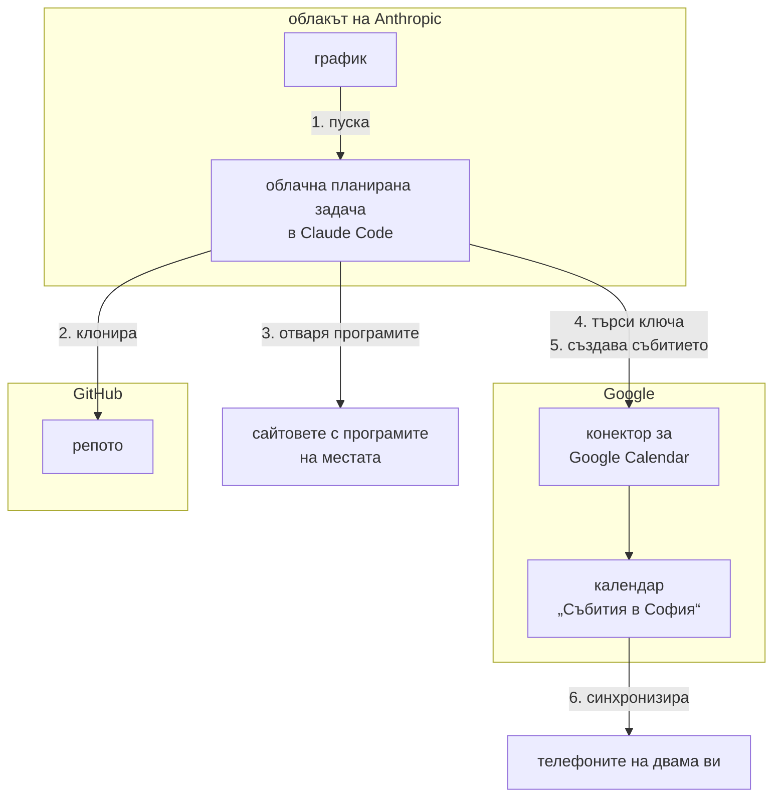

# Архитектура на решението

Избраното решение по [Задание.md, т. 2](Задание.md#2-ясна-задача-task), към 2026-11-07. Проучените варианти и резервните пътища са в [Автоматизация.md](Автоматизация.md). Какво още предстои да се реши: вж. [Прогрес.md → Отворени въпроси](Прогрес.md#отворени-въпроси) и [Задачи за следващите части](Прогрес.md#задачи-за-следващите-части).

## Схема

Всяка стрелка тръгва от този, който действа. Номерът е стъпката от [Едно пускане](#едно-пускане), а рамките показват чия е всяка част.

## Части на решението

| Част | Какво е | Данни и настройки |
|---|---|---|
| **Репо** | Частното [yankogovedarov/sofia-events-agent](https://github.com/yankogovedarov/sofia-events-agent), основен клон `main` | Инструкцията за агента (пише се в [част 3](Прогрес.md#части-на-проучването)), [Индекс-места.md](Индекс-места.md) и критериите и бюджетът от Задание.md, [т. 3](Задание.md#3-контекст-и-подробности-context), [т. 5](Задание.md#5-ограничения-и-насоки-constraints) и [т. 6](Задание.md#6-примери-few-shot-prompting) |
| **Облачна планирана задача** | Cloud scheduled task в Claude Code, доскоро „routine“. Върви в облака на Anthropic, затова не е нужно компютърът ви да е включен | Вж. [Работа на задачата](#работа-на-задачата) и [Права и достъп](#права-и-достъп) |
| **Конектор за Google Calendar** | Вграденият конектор на Claude. Прави го Google и това е Calendar MCP сървърът на Google (`calendarmcp.googleapis.com`) | Свързан е с Google акаунта `yanko.govedarov123@gmail.com`. Правата: вж. [Права и достъп](#права-и-достъп) |
| **Календар „Събития в София“** | Отделен календар в Google Calendar за двама ви | Id: `002a78b3ef1111a8066c5cae20613cece50ca6f435b97dea0c0db073e88fbf99@group.calendar.google.com`. Още не е споделен със съпругата ви, вж. стъпка 6 в [Стъпки за настройка](#стъпки-за-настройка). След споделянето събитията ще се виждат и в двата ви телефона, а известията ще работят при всеки от вас |

## Едно пускане

1. Графикът пуска задачата, вж. [Честота](#честота).
2. Задачата клонира репото и чете от него файловете, изброени в [Части на решението](#части-на-решението).
3. Задачата отваря програмите на местата от индекса и избира събитията в хоризонта от [Честота](#честота), които отговарят на критериите и бюджета.
4. За всяко избрано събитие задачата търси ключа му в календара през конектора, вж. [Дубликати](#дубликати).
5. Ако не го намери, задачата създава събитието през конектора по [Запис в календара](#запис-в-календара).
6. Google синхронизира календара с телефоните на двама ви.

## Запис в календара

- **Календар.** Събитието се създава с `create_event` и `calendarId` на „Събития в София“. Без `calendarId` то отива в основния календар.
- **Часова зона.** Агентът винаги подава `timeZone: Europe/Sofia`. Без нея часът се тълкува в зоната на акаунта, а тя е UTC. При пробата в чат събитие за 19:00 се записа за 21:00 в София.
- **Гости.** Инструментът приема гости, а с тях тръгват покани. Само инструкцията пречи на агента да ги добави.

### Дубликати

Всяко събитие получава стабилен ключ, например линк към събитието + дата и час. Ключът стои в описанието на събитието, а агентът го търси в календара, преди да създаде ново. Търсенето го прави самият агент, така че може да пропусне вече записано събитие и да го създаде втори път. Ако изтриете събитие от календара, ключът изчезва с него и следващото пускане ще го създаде наново, докато събитието е в програмата. Потребителят реши ключовете да стоят само в самите събития (2026-11-06).

## Права и достъп

- **Права на инструментите.** Задават се в Claude → Customize → Connectors → Google Calendar → Tool permissions. Кои права да се зададат, е **нерешено**. Предложение: `create_event`, `list_events`, `search_events` и `get_event` на Always allow, а `delete_event`, `update_event` и `respond_to_event` на Blocked. Инструментите за търсене са нужни за проверката за [дубликати](#дубликати). Дали тези настройки важат и при пускане без надзор, е **непотвърдено**: при пробата на 2026-11-06 задачата виждаше всички инструменти, включително `delete_event`, но не е проверено дали тогава правата са били зададени. Отговорът на API за задачите съдържа и поле `permitted_tools` за всеки конектор. То не е описано в документацията и не е пробвано.
- **Прикачени конектори.** Задачата получава само конектора `Google_Calendar`. Ако при създаването ѝ не се посочат конектори, сървърът прикача всички свързани. Така при пробата бяха прикачени и `Claude_Docs` и `Claude_Code_Remote`.
- **Достъп.** Конекторът стига до всички календари на свързания акаунт, а агентът чете чужди страници. Правата се задават по инструмент, а не по календар, така че агентът вижда и личния календар и може да създава събития в него. Затова защитата са правата и инструкцията за агента.

## Работа на задачата

### Честота

Веднъж седмично, с хоризонт 4 седмици напред. Потребителят прие това предложение на 2026-11-07. Часът в cron е в UTC, а София е UTC+2 през зимата и UTC+3 през лятото.

### Разход

Абонаментът е Pro (отговор на потребителя от 2026-11-07), а при него лимитът е по-малък, отколкото при Max. Всяко пускане е пълна сесия на Claude Code и харчи от този лимит. С десетки отворени страници едно пускане може да изхаби голяма част от 5-часовия лимит, затова трябва да е в час, когато не работите. Ако лимитът е изчерпан, пускането се отхвърля, а ако се изчерпа по време на пускането, то спира. Разходът зависи и от модела на задачата. Кой модел да е, е **нерешено**.

### Мрежа

Средата Default е с мрежов достъп Trusted, който пуска само определен списък домейни. За да се отварят сайтовете на местата, средата на задачата трябва да е с достъп Full или Custom (със списък на домейните от индекса). Кое от двете, е **нерешено**. Дали инструментът за отваряне на страници (WebFetch) минава през този списък, е **непотвърдено**. Конекторите минават през сървърите на Anthropic и не искат промяна в мрежовия списък.

### Без надзор

Облачните пускания вървят в auto mode. В него пращането на чувствителни данни към външни адреси е сред блокираното по подразбиране, а запазеният промпт на задачата не се брои за одобрение. Пускане може да е със статус „Succeeded“ и когато някое действие е блокирано, така че статусът не доказва, че събитията са записани.

## Проби

[Документацията на конектора](https://claude.com/docs/connectors/google/calendar) казва, че той само чете. [Страницата на конектора](https://claude.com/marketplace/connectors/google-calendar) обаче изброява `create_event`, `update_event`, `delete_event` и `respond_to_event`, а [помощната статия](https://support.claude.com/en/articles/10166901-use-google-workspace-connectors) описва създаване, промяна и триене. Двете проби от 2026-11-06 показаха, че документацията е остаряла:

- **В чат с включен конектор.** Записът работи и събитието попада в посочения календар.
- **В еднократна облачна задача без надзор.** Събитието е записано за 26 секунди, без искане за одобрение, в правилния календар и с правилния час. Задачата беше с модел Sonnet и среда Default (мрежов достъп Trusted), без репо и без четене на сайтове, така че пробата не показва дали записът минава и след четене на чужди страници. Агентът сам прати и известие на телефона, без да е поискано.

## Стъпки за настройка

Стъпка 1 е готова, а 2–5 се правят в част 3: 1–4 са нужни за пробното пускане, а 5 е самата проба. Графикът от [Честота](#честота) се добавя в част 4, а стъпка 6 е след нея (решение на потребителя от 2026-11-07).

1. **Google Calendar.** Календарът „Събития в София“ вече съществува.
2. **Конектор.** Вече е свързан. Остава да се настроят правата, вж. [Права и достъп](#права-и-достъп).
3. **GitHub.** Към 2026-11-06 GitHub не е свързан с Claude акаунта, а без това задачата не може да клонира частното репо. Свързва се на [claude.ai/connect-github](https://claude.ai/connect-github) или с `/web-setup`.
4. **Claude.**
   - Облачна среда с мрежов достъп според [Мрежа](#мрежа).
   - Облачна планирана задача с репото, само с конектора `Google_Calendar` (вж. [Права и достъп](#права-и-достъп)) и с инструкцията за агента ([част 3](Прогрес.md#части-на-проучването)). Дали задачата има нужда от право за запис в репото, зависи от решението в част 3 как агентът приема нови места.
5. **Проверка.** Пускате задачата с „Run now“ и гледате календара.
6. **Споделяне.** Споделяте календара с Google акаунта на съпругата ви.

## Източници

Claude:
- [Облачни планирани задачи (scheduled tasks / routines)](https://code.claude.com/docs/en/routines): график, репо, конектори, мрежа, лимити.
- [Облачни среди](https://code.claude.com/docs/en/cloud-environments): нива на мрежов достъп и домейни по подразбиране.
- [Auto mode](https://code.claude.com/docs/en/permission-modes): какво блокира по подразбиране.
- [Claude Code в облака](https://code.claude.com/docs/en/claude-code-on-the-web): разход.
- [Документация на Google Calendar конектора](https://claude.com/docs/connectors/google/calendar): твърди, че само чете.
- [Страница на Google Calendar конектора](https://claude.com/marketplace/connectors/google-calendar): прави го Google, адресът и инструментите.
- [Помощна статия за Google Workspace конекторите](https://support.claude.com/en/articles/10166901-use-google-workspace-connectors): създаване, промяна и триене на събития.
- [Права на инструментите в конектор](https://claude.com/docs/connectors/getting-started): Always allow, Needs approval, Blocked.

Google:
- [Calendar MCP сървърът на Google](https://developers.google.com/workspace/calendar/api/guides/configure-mcp-server): адресът `calendarmcp.googleapis.com/mcp/v1`.
- [`create_event` в Calendar MCP](https://developers.google.com/workspace/calendar/api/v3/reference/mcp/tools_list/create_event): параметри на инструмента.
- [Споделяне на календар](https://support.google.com/calendar/answer/37082).
